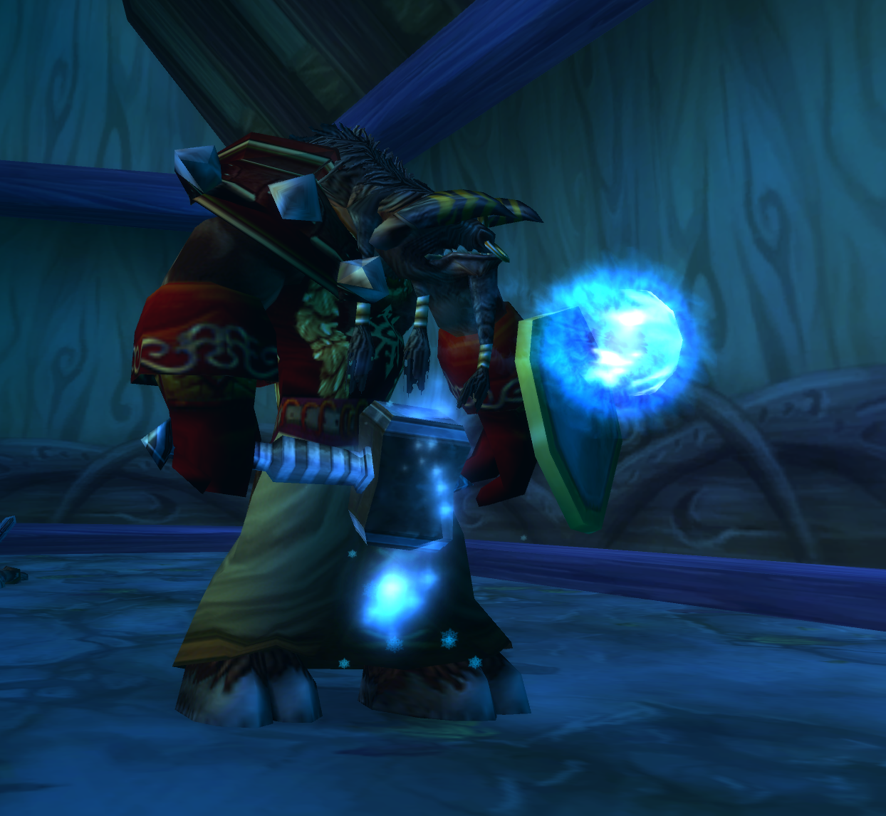
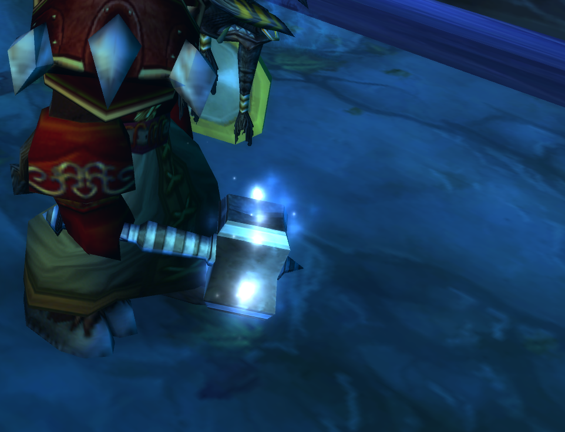
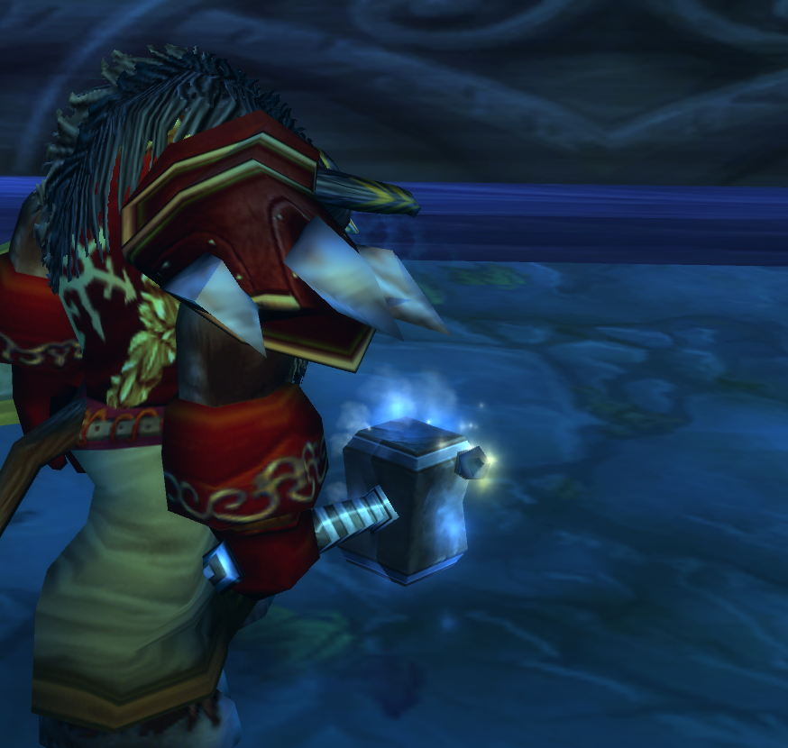
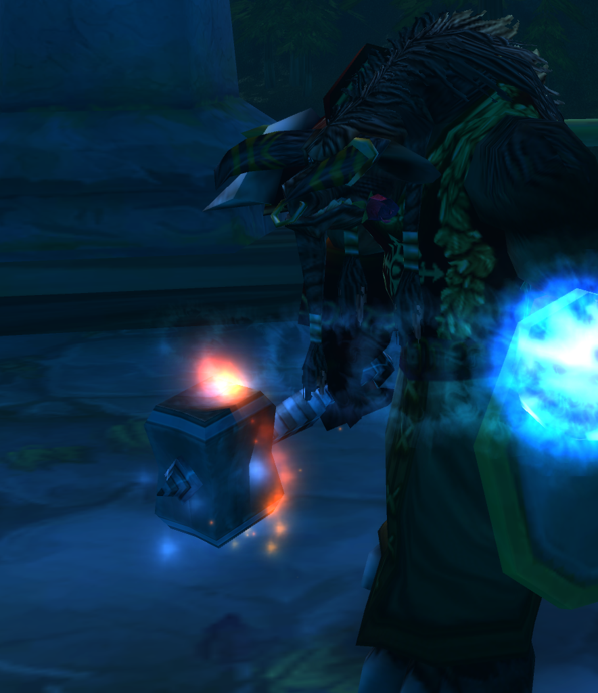

# Octo Enchant Visuals

Keep your permanent weapon enchant glow **and** your shaman imbue visible at the same time.

A small cosmetic client mod for **OctoWoW**, supporting Rockbiter, Flametongue, Windfury, and Frostbrand. Your +4 weapon damage enchant can keep its blue glow while the shaman effect plays around the same weapon.

**[Download the latest release](https://github.com/Morkahja/OctoEnchantVisuals/releases/latest)**

## In game

Screenshots of the working mod, showing a permanent blue enchant glow together with each imbue.

| Frostbrand | Windfury |
| :---: | :---: |
|  |  |
| **Rockbiter** | **Flametongue** |
|  |  |

## Install

Requires the supported **32-bit OctoWoW 1.12.1 (5875) client** and an existing launcher/DLL loader that reads `dlls.txt` beside `WoW.exe`. This is a native client mod, not an Interface/AddOns addon. Other client builds are not supported.

1. Download **OctoEnchantVisuals-1.0.zip** from Releases, and extract it outside your game folder.
2. Fully close WoW. The launcher can stay open.
3. Open PowerShell in the extracted folder and run:

   ```powershell
   powershell -ExecutionPolicy Bypass -File .\Install.ps1 -ClientPath "C:\Games\OctoWoW"
   ```

   Replace the example path with the folder containing your `WoW.exe`. Omitting `-ClientPath` prompts for the folder.
4. Start the game through your usual DLL-loading launcher. If it lists individual mods, enable **OctoEnchantVisualsDiagnostic.dll**.

The installer checks the executable and release DLL checksums, preserves other loader entries, and saves backups beside the script. It also removes the recognized obsolete `OctoEnchantVisuals.dll` from earlier testing. Only **one mod DLL** is needed; the matching INI is its configuration file.

The working release keeps the name `OctoEnchantVisualsDiagnostic.dll` so it uses the exact binary tested in game.

## Disable or remove

Set `EnableHooks=0` in `OctoEnchantVisualsDiagnostic.ini` beside WoW.exe, then fully exit and restart WoW. Set it back to `1` to re-enable. A UI reload is not enough.

To uninstall, close WoW and run the extracted installer:

```powershell
powershell -ExecutionPolicy Bypass -File .\Install.ps1 -ClientPath "C:\Games\OctoWoW" -Uninstall
```

Existing diagnostic logs are left in place and can be deleted while the game is closed.

## What it changes

The DLL extends the client's weapon visual selection and attachment routines using MinHook. It renders both qualifying effects with the game's existing visuals. It does not change enchant stats, game assets, the executable on disk, or network settings.

The result is local to your computer. Qualifying weapons on other characters can also show both effects on your screen; other players need their own installation to see the change.

## Tested behavior and limitations

Confirmed in game on September 11, 2026:

- Full login and world entry, including repeated game restarts.
- Permanent enchant glow combined with all four shaman imbues.
- Replacing one imbue with another.
- Sheathing and unsheathing.

Natural imbue expiration has not yet been visually checked in game because the server's imbues last an hour. Cleanup logic passed offline tests. Equipment swaps have not been separately confirmed.

Weapons whose built-in visual takes priority retain the original priority rule. Non-shaman temporary enchants are outside this mod's scope.

Earlier development builds had reported login/loading failures whose cause was not conclusively established. This release preserves the later binary that passed the live tests. If you encounter a problem, disable the mod, restart, and report your client version and reproduction steps in [Issues](https://github.com/Morkahja/OctoEnchantVisuals/issues).

Diagnostic logging remains enabled in `OctoEnchantVisualsDiagnostic.log`, capped at 20,000 trace events per game session. Review logs before sharing them.

### Exact compatibility

The installer refuses a different executable. Runtime code signatures provide an additional check.

| File | SHA-256 |
| --- | --- |
| Supported WoW.exe | `183cd1128bcb9fa7d1bc7b3eaaa3ab384f71fdaadfa1be3ad8d458e93587d4bd` |
| Release DLL | `70d6b81bf77393925bdeab9c3813679fc36ee29a9f3460303039e95d245ae4d5` |

## Build from source

Install Visual Studio C++ Build Tools with the Windows SDK. Open an **x86 Native Tools Command Prompt**, then run:

```bat
build.cmd
```

This runs the visual-pair unit tests and builds `dist\OctoEnchantVisualsDiagnostic.dll` using the static C runtime. MinHook 1.3.4 is included under `vendor/`.

The release download preserves the original tested DLL. Rebuilds may have different checksums; the release installer deliberately accepts only the published binary. Developer builds require manual placement of the DLL and INI beside WoW.exe and one matching entry in `dlls.txt`, while WoW is closed.

## License and credits

Original mod code is MIT licensed; see [LICENSE](LICENSE). [MinHook](https://github.com/TsudaKageyu/minhook) retains its [BSD license](vendor/minhook-1.3.4/LICENSE.txt).

Screenshots depict World of Warcraft; game artwork belongs to its respective owners. This is an independent community project.
